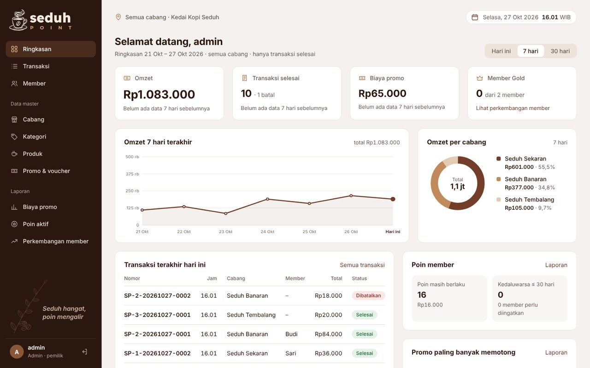
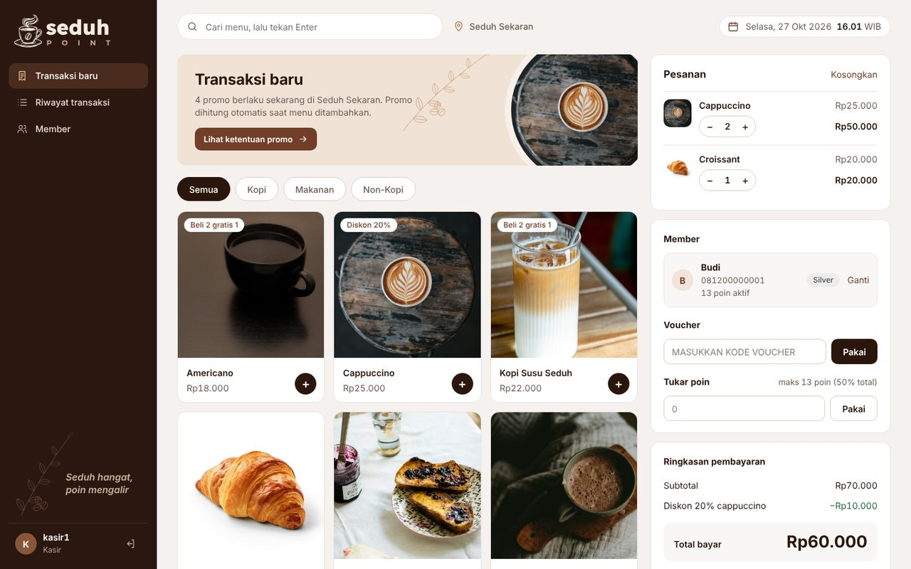
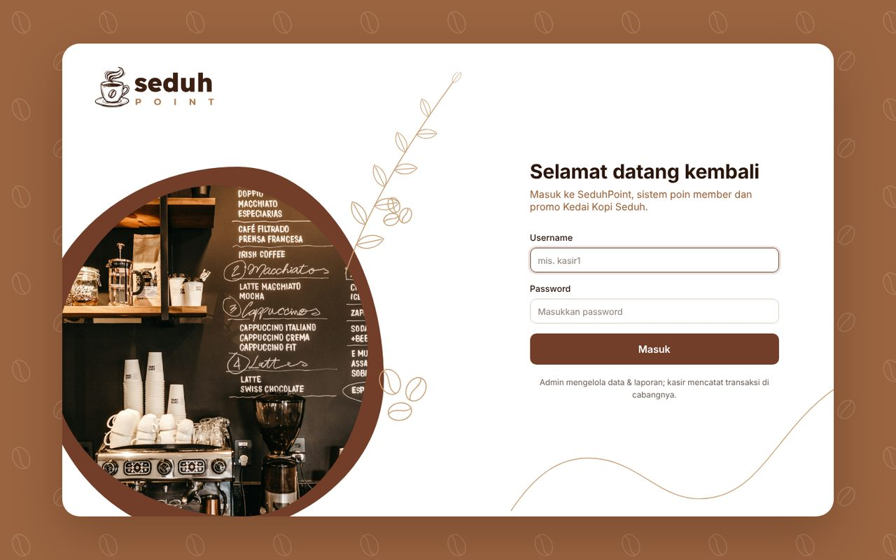
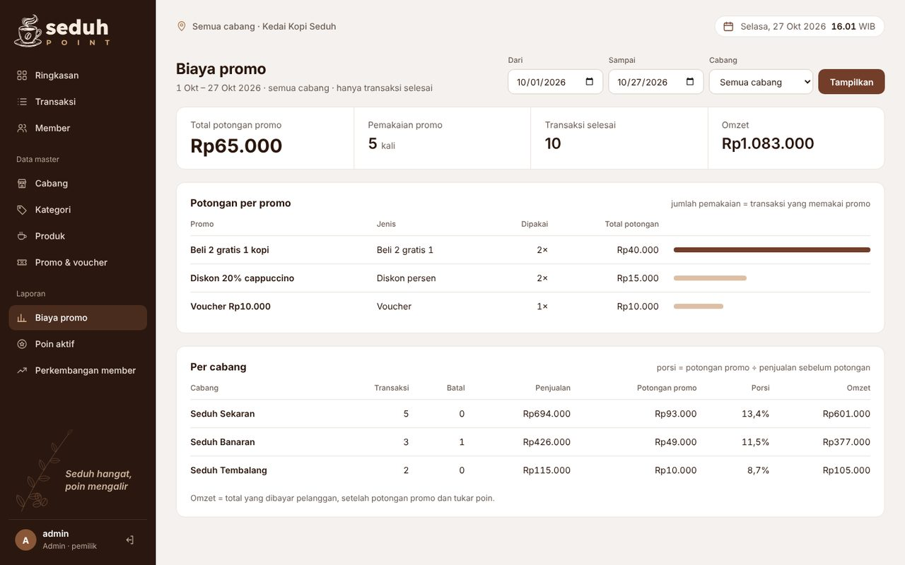
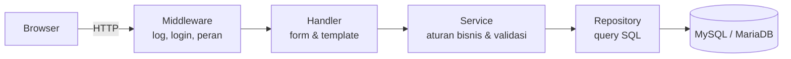

<div align="center">

<picture>
  <source media="(prefers-color-scheme: dark)" srcset=".github/assets/logo-gelap.svg">
  
</picture>

### Sistem poin member dan promo untuk kedai kopi dengan banyak cabang

Kasir mencatat transaksi, sistem menghitung promo dan poin secara otomatis,<br>
pemilik memantau biaya promo, poin beredar, dan perkembangan member dari satu tempat.

<p>
  
  
  
  
</p>

<p>
  <a href="#fitur">Fitur</a> ·
  <a href="#tangkapan-layar">Tangkapan layar</a> ·
  <a href="#mulai-cepat">Mulai cepat</a> ·
  <a href="#arsitektur">Arsitektur</a> ·
  <a href="#struktur-proyek">Struktur proyek</a>
</p>



</div>

## Fitur

<table>
<tr>
<td width="50%" valign="top">

### Kasir
- Menu bergambar per kategori dan pencarian menu
- Kartu detail menu: deskripsi, harga, promo yang berlaku
- Promo dihitung otomatis, ketentuannya bisa dilihat kapan saja
- Pilih member, pakai voucher, tukar poin
- Pembayaran aman dari klik ganda, lalu struk
- Riwayat dan pembatalan transaksi (kasir: hanya transaksi hari ini)

</td>
<td width="50%" valign="top">

### Member & poin
- 1 poin setiap Rp10.000 belanja setelah promo, 1 poin = Rp1.000
- Poin berlaku 6 bulan, yang paling dekat kedaluwarsa dipakai dulu
- Penukaran maksimal 50% dari total belanja
- Tingkat **Silver** dan **Gold** (belanja ≥ Rp1.500.000 dalam 3 bulan, poin 1,5×)
- Evaluasi tingkat dan kedaluwarsa poin berjalan otomatis setiap hari

</td>
</tr>
<tr>
<td valign="top">

### Promo & voucher
- Diskon persen untuk produk tertentu
- Potongan untuk minimal belanja
- Beli 2 gratis 1 untuk kategori tertentu
- Voucher berkode dengan kuota pemakaian
- Masa berlaku, batasan cabang, dan batasan jam
- Minimal belanja dan voucher tidak digabung: sistem memilih potongan yang lebih besar

</td>
<td valign="top">

### Admin & laporan
- Kelola cabang, kategori, produk (dengan foto), member, promo
- Ringkasan omzet, transaksi, biaya promo, member Gold
- Grafik omzet harian dan omzet per cabang, dibanding periode sebelumnya
- Laporan biaya promo (filter tanggal & cabang)
- Laporan poin aktif dan poin yang akan kedaluwarsa
- Laporan perkembangan member per bulan

</td>
</tr>
</table>

## Tangkapan layar

<table>
  <tr>
    <td></td>
    <td></td>
  </tr>
  <tr>
    <td align="center"><b>Kasir</b>: menu, pesanan, member, voucher, tukar poin</td>
    <td align="center"><b>Login</b>: admin dan kasir per cabang</td>
  </tr>
  <tr>
    <td></td>
    <td></td>
  </tr>
  <tr>
    <td align="center"><b>Ringkasan</b>: omzet, grafik, cabang, poin</td>
    <td align="center"><b>Laporan</b>: biaya promo per promo dan per cabang</td>
  </tr>
</table>

## Teknologi

<p>
  
</p>

| Lapisan | Teknologi |
|---|---|
| Backend | Go standard library: `net/http` (routing Go 1.22), `html/template`, `database/sql` |
| Database | MySQL 8 atau MariaDB 10.6+ lewat `go-sql-driver/mysql` |
| Keamanan | Password `bcrypt`, ganti password, sesi berakhir setelah 8 jam, token CSRF di setiap form, pembatasan peran, query berparameter, transaksi database dengan `SELECT ... FOR UPDATE` |
| Tampilan | HTML yang dirender di server, CSS dan JavaScript sendiri tanpa framework |
| Konfigurasi | File `.env` lewat `joho/godotenv` |

## Mulai cepat

### Kebutuhan

- [Go](https://go.dev/dl/) 1.22 atau lebih baru
- MySQL 8 atau MariaDB 10.6+, pilih salah satu:

| Pilihan | Cara menyalakan |
|---|---|
| [Laragon](https://laragon.org) (Windows) | Klik **Start All** |
| [XAMPP](https://www.apachefriends.org) (Windows, Linux, macOS) | Klik **Start** pada MySQL di XAMPP Control Panel |
| Docker | `docker run -d --name seduhpoint-db -p 3306:3306 -e MYSQL_ALLOW_EMPTY_PASSWORD=yes mysql:8` |
| MySQL / MariaDB terpasang | Pastikan service-nya berjalan di port 3306 |

### 1. Ambil kode

```bash
git clone https://github.com/AchmadFauzan1156/SeduhPoint.git
cd SeduhPoint
```

### 2. Buat database

```bash
mysql -u root --default-character-set=utf8mb4 -e "source db/seduhpoint.sql"
```

File `db/seduhpoint.sql` membuat database, seluruh tabel, dan data contoh. Untuk mengulang dari awal, jalankan
`mysql -u root -e "DROP DATABASE IF EXISTS seduhpoint"` lebih dulu. Tambahkan `-p` jika user MySQL memakai password.

<details>
<summary>Perintah <code>mysql</code> tidak dikenali?</summary>

Pakai path lengkapnya, atau jalankan isi `db/seduhpoint.sql` dari phpMyAdmin / HeidiSQL (tab SQL atau Import).

| Server | Lokasi `mysql` |
|---|---|
| Laragon | `C:\laragon\bin\mysql\mysql-<versi>\bin\mysql.exe`, atau buka **Menu → Terminal** di Laragon |
| XAMPP Windows | `C:\xampp\mysql\bin\mysql.exe` |
| XAMPP Linux | `/opt/lampp/bin/mysql` |
| XAMPP macOS | `/Applications/XAMPP/xamppfiles/bin/mysql` |
| Docker | `docker exec -i seduhpoint-db mysql -u root < db/seduhpoint.sql` |

</details>

### 3. Atur koneksi

```bash
cp .env.example .env        # Windows CMD: copy .env.example .env
```

| Variabel | Default | Keterangan |
|---|---|---|
| `ADDR` | `127.0.0.1:8080` | Alamat server web |
| `DB_DSN` | `root:@tcp(127.0.0.1:3306)/seduhpoint?parseTime=true&charset=utf8mb4&loc=Asia%2FJakarta` | Koneksi database: `user:password@tcp(host:port)/nama_database` |

### 4. Jalankan

```bash
go run ./cmd/web
```

Buka **http://localhost:8080**. Untuk muat ulang otomatis saat kode berubah, pakai [wgo](https://github.com/bokwoon95/wgo):

```bash
go install github.com/bokwoon95/wgo@latest
wgo run -file .html -file .css ./cmd/web
```

### Akun contoh

| Username | Password | Peran |
|---|---|---|
| `admin` | `password` | Admin / pemilik, semua cabang |
| `kasir1` | `password` | Kasir Seduh Sekaran |
| `kasir2` | `password` | Kasir Seduh Banaran |
| `kasir3` | `password` | Kasir Seduh Tembalang |

Data contoh berisi 3 cabang, 7 menu, 2 member, dan 4 promo (satu dari tiap jenis, kode voucher `SEDUH10`) yang
berlaku 1 Okt sampai 31 Des 2026. Ubah tanggal promo di menu **Promo & voucher** bila perlu, dan ganti password
akun lewat menu **Ganti password** sebelum dipakai sungguhan.

## Pengujian

```bash
go test ./...
```

Test mencakup perhitungan promo bertumpuk, batas tukar poin, poin Silver dan Gold, validasi promo,
ketentuan promo, serta data grafik dan laporan.

## Arsitektur



- **Handler** hanya mengurus HTTP: membaca form, memanggil service, merender template.
- **Service** berisi aturan bisnis dan tidak tahu soal HTTP maupun SQL. Perhitungan promo dan poin ada di
  `internal/service/hitung.go` dan bisa diuji tanpa database.
- **Repository** adalah satu-satunya tempat query SQL.
- Setiap perubahan saldo poin, transaksi, atau kuota voucher berjalan dalam satu transaksi database dengan
  penguncian baris, sehingga aman dipakai beberapa kasir sekaligus.
- Nilai uang disimpan sebagai bilangan bulat rupiah. Data master memakai soft delete, transaksi batal tetap
  tersimpan, dan riwayat mutasi poin tidak pernah diubah.

## Struktur proyek

```
SeduhPoint/
├── cmd/web/main.go        titik masuk: konfigurasi, database, route, job harian
├── internal/
│   ├── config/            membaca .env dan zona waktu WIB
│   ├── model/             struct data
│   ├── repository/        query SQL, satu file per entitas
│   ├── service/           aturan bisnis, validasi, perhitungan promo & poin
│   ├── handler/           handler HTTP dan helper template
│   └── middleware/        logging, sesi login, pembatasan peran
├── db/seduhpoint.sql      database, tabel, dan data contoh
├── templates/             template HTML per halaman
└── static/                CSS, JavaScript, logo, foto menu
```

## Catatan

- Jam promo dan tanggal mengikuti WIB (Asia/Jakarta).
- Sesi login disimpan di memori server, jadi pengguna perlu login ulang setelah server dimulai ulang.

## Kredit

Foto menu dan foto login dari [Unsplash](https://unsplash.com/license). Font Inter, Plus Jakarta Sans, Lexend,
dan Montserrat berlisensi SIL Open Font License. Rincian ada di [`static/img/KREDIT.md`](static/img/KREDIT.md).
